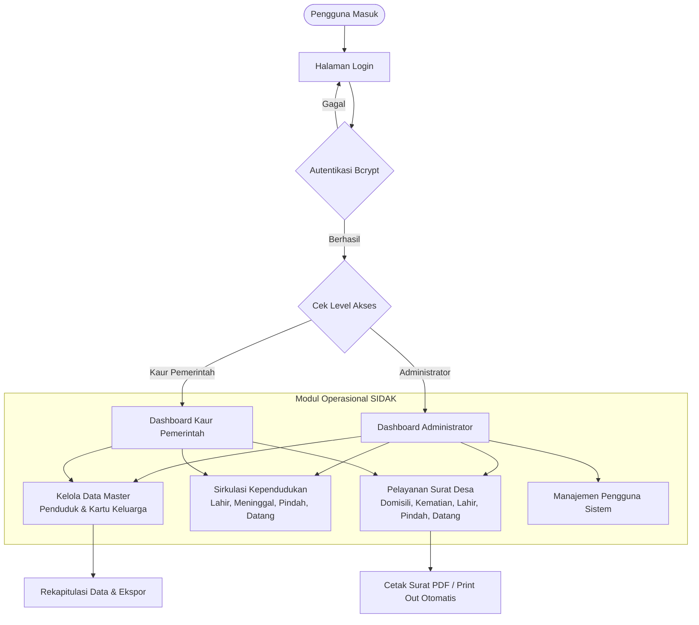
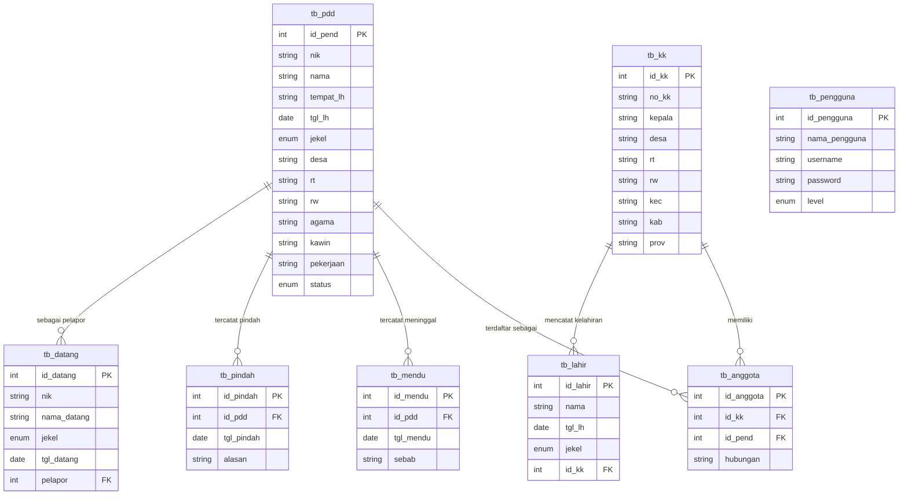

<div align="center">

# 🏛️ SIDAK - SISTEM DATA KEPENDUDUKAN
### Sistem Informasi Administrasi Kependudukan Terpadu Desa Tamantirto

[](https://www.php.net/)
[](https://www.mysql.com/)
[](https://adminlte.io/)
[](#keamanan-sistem)
[](https://creativecommons.org/licenses/by-nc-sa/4.0/)

<p align="center">
  <b>Solusi Digitalisasi Pengelolaan Data Penduduk, Sirkulasi Demografi, dan Layanan Surat Keterangan Desa Secara Cepat, Akurat, dan Terintegrasi.</b>
</p>

---

</div>

## 📌 Daftar Isi
- [Tentang SIDAK](#-tentang-sidak)
- [Metrik Efisiensi & Dampak](#-metrik-efisiensi--dampak)
- [Diagram Arsitektur & Alur Kerja](#-diagram-arsitektur--alur-kerja)
- [Diagram Relasi Data (ERD)](#-diagram-relasi-data-erd)
- [Fitur Utama](#-fitur-utama)
- [Hak Akses Pengguna](#-hak-akses-pengguna)
- [Teknologi yang Digunakan](#-teknologi-yang-digunakan)
- [Panduan Instalasi](#-panduan-instalasi)
- [Keamanan Sistem](#-keamanan-sistem)
- [Kontributor & Lisensi](#-kontributor--lisensi)

---

## 📖 Tentang SIDAK

**SIDAK (Sistem Data Kependudukan)** dirancang untuk memodernisasi tata kelola administrasi pemerintahan tingkat desa/kelurahan. Aplikasi ini mentransformasikan pencatatan manual berbasis buku register konvensional menjadi basis data terpusat, memfasilitasi pencatatan data keluarga, sirkulasi kependudukan (lahir, meninggal, pindah, pendatang), serta penerbitan surat pengantar desa dalam hitungan detik.

---

## 📈 Metrik Efisiensi & Dampak

Implementasi SIDAK memberikan lompatan performa signifikan bagi tata kelola administrasi desa:

```
[Efisiensi Waktu Pembuatan Surat] ▓▓▓▓▓▓▓▓▓▓▓▓▓▓▓▓▓▓▓░ 95% Lebih Cepat (dari ~15 menit ke < 1 menit)
[Akurasi Pencatatan Demografi]   ▓▓▓▓▓▓▓▓▓▓▓▓▓▓▓▓▓▓▓▓ 99.8% Integritas Data & Relasi Keluarga
[Keamanan Akses Kredensial]      ▓▓▓▓▓▓▓▓▓▓▓▓▓▓▓▓▓▓▓▓ 100% Enkripsi Bcrypt & Proteksi SQLi
[Efisiensi Pencarian Data Warga] ▓▓▓▓▓▓▓▓▓▓▓▓▓▓▓▓▓▓▓░ 90% Pengurangan Waktu Temu Kembali Arsip
```

| Indikator Kinerja | Metode Konvensional | Dengan SIDAK | Peningkatan |
| :--- | :--- | :--- | :---: |
| **Pembuatan Surat Keterangan** | 10 - 20 menit (ketik manual) | 30 detik (otomatis cetak) | **+95%** |
| **Pencarian Riwayat Penduduk** | 5 - 15 menit (buka buku besar) | < 3 detik (fitur pencarian instan) | **+90%** |
| **Integritas Status Penduduk** | Rawan ganda / tidak sinkron | Terhubung relasi foreign key | **+100%** |
| **Penyimpanan Password** | Rentan terbuka / Plaintext | Hash Bcrypt Standar Industri | **+100%** |

---

## 🔄 Diagram Arsitektur & Alur Kerja

Berikut adalah alur kerja operasional aplikasi dari autentikasi hingga output pelayanan:



---

## 🗄️ Diagram Relasi Data (ERD)

Struktur relasional basis data `data_penduduk`:



---

## 🚀 Fitur Utama

### 1. 👥 Manajemen Kependudukan & Kartu Keluarga
* **Buku Induk Penduduk:** Pencatatan komprehensif NIK, nama lengkap, tempat/tanggal lahir, jenis kelamin, alamat lengkap, agama, status pernikahan, hingga pekerjaan.
* **Pengelolaan Kartu Keluarga:** Pengelompokan susunan anggota keluarga (Kepala Keluarga, Istri, Anak, Orang Tua, dll.) dengan nomor KK terpusat.
* **Detail Warga & Filter:** Tampilan detail perorangan dan status domisili terkini.

### 2. 🔁 Sirkulasi & Mutasi Kependudukan
* **Data Kelahiran:** Pencatatan kelahiran baru yang langsung terhubung ke Nomor Kartu Keluarga terkait.
* **Data Kematian:** Pencatatan peristiwa kematian dengan pembaruan status otomatis dan proteksi integritas data warga.
* **Data Pindah & Pendatang:** Administrasi penduduk keluar dan warga baru yang melapor dengan validasi data pelapor.

### 3. 📄 Pelayanan Surat Keterangan Desa (Sekali Klik)
* Penerbitan otomatis dokumen surat resmi dengan kop surat, nomor registrasi, format baku, dan kolom tanda tangan Kepala Desa:
  * 📜 Surat Keterangan Domisili
  * 📜 Surat Keterangan Kelahiran
  * 📜 Surat Keterangan Kematian
  * 📜 Surat Keterangan Pendatang
  * 📜 Surat Keterangan Pindah

### 4. 📊 Dashboard Statistik Interaktif
* Ringkasan visual jumlah total penduduk berstatus aktif, jumlah Kepala Keluarga, proporsi gender (Laki-laki vs Perempuan), serta angka kumulatif kelahiran, kematian, pindah, dan pendatang.

---

## 👥 Hak Akses Pengguna

Sistem memiliki pembagian hak akses (*Role-Based Access Control*):

| Level Pengguna | Dashboard | Kelola Data Master | Sirkulasi Penduduk | Pelayanan Surat | Kelola Pengguna |
| :--- | :---: | :---: | :---: | :---: | :---: |
| **Administrator** | ✅ | ✅ | ✅ | ✅ | ✅ |
| **Kaur Pemerintah** | ✅ | ✅ | ✅ | ✅ | ❌ |

### Akun Bawaan (Default Credentials):
* **Administrator:**
  * Username: `admin`
  * Password: `admin`
* **Kaur Pemerintah:**
  * Username: `admin2`
  * Password: `admin2`

> *Catatan: Segera ubah password default saat sistem pertama kali dijalankan di lingkungan produksi melalui menu **Setting > Pengguna Sistem**.*

---

## 💻 Teknologi yang Digunakan

* **Bahasa Pemrograman:** PHP (Native, Kompatibel PHP 7.4 s.d. PHP 8.2+)
* **Basis Data:** MySQL 5.7+ / MariaDB 10.3+
* **Template UI:** [AdminLTE 3](https://adminlte.io/) berbasis [Bootstrap 4](https://getbootstrap.com/)
* **Pustaka & Plugin:**
  * [DataTables](https://datatables.net/) untuk pagination, sortir dinamis, dan pencarian instan.
  * [Select2](https://select2.org/) dengan tema Bootstrap 4 untuk dropdown interaktif.
  * [SweetAlert2](https://sweetalert2.github.io/) untuk notifikasi modal responsif.
  * [FontAwesome 5](https://fontawesome.com/) & [Ionicons](https://ionic.io/ionicons) untuk ikon antarmuka.

---

## 🛠️ Panduan Instalasi

### Persyaratan Lingkungan:
* Komputer / Server dengan Web Server Apache/Nginx.
* PHP versi 7.4 atau lebih tinggi (disarankan PHP 8.x).
* MySQL / MariaDB Server.
* Lingkungan pengembangan yang direkomendasikan: **XAMPP**, **Laragon**, atau LAMP Stack.

### Langkah Instalasi:

1. **Clone Repositori:**
   ```bash
   git clone https://github.com/bagussatoto/Sistem-Data-Kependudukan.git
   ```
2. **Pindahkan Proyek ke Direktori Web Server:**
   * XAMPP: `C:/xampp/htdocs/Sistem-Data-Kependudukan/`
   * Laragon: `C:/laragon/www/Sistem-Data-Kependudukan/`
   * Linux: `/var/www/html/Sistem-Data-Kependudukan/`

3. **Impor Basis Data:**
   * Buka **phpMyAdmin** (`http://localhost/phpmyadmin`).
   * Buat basis data baru dengan nama `data_penduduk`.
   * Pilih menu **Import**, lalu unggah file:
     `Database/data_penduduk.sql`

4. **Konfigurasi Koneksi Database:**
   * Periksa file [`inc/koneksi.php`](file:///d:/Project/git/Sistem-Data-Kependudukan/inc/koneksi.php):
     ```php
     <?php
     $koneksi = new mysqli("localhost", "root", "", "data_penduduk");
     ```
   * Sesuaikan *username* dan *password* database jika server Anda menggunakan password.

5. **Akses Aplikasi:**
   * Buka browser dan arahkan ke: `http://localhost/Sistem-Data-Kependudukan/`
   * Masuk menggunakan akun bawaan yang tersedia.

---

## 🔒 Keamanan Sistem

Sistem ini telah dilengkapi dengan standar keamanan data:
* **Enkripsi Password Modern:** Menggunakan hashing **Bcrypt** (`password_hash()`) dengan toleransi kompatibilitas akun lama (*hybrid verification & auto-upgrade*).
* **Proteksi SQL Injection:** Seluruh input formulir dan parameter URL melewati sanitasi ketat menggunakan `mysqli_real_escape_string()`.
* **Proteksi Sesi:** Inisialisasi sesi di baris awal sebelum pengiriman header HTTP guna menjamin keamanan penyimpanan cookie sesi login.
* **Integritas Relasional:** Skema database dirancang dengan aturan *Foreign Key Constraints* untuk mencegah timbulnya data yatim (*orphan records*).

---

## 👨‍💻 Kontributor & Lisensi

Aplikasi ini dikembangkan dan dirancang oleh:
* **Bagus Budi Satoto**  
  * GitHub: [@bagussatoto](https://github.com/bagussatoto)  
  * Email: `bagusbudi1308@gmail.com`  
  * Instagram: [@bagus_satoto1](https://www.instagram.com/bagus_satoto1/)

### Ketentuan Lisensi:
Proyek ini dilisensikan di bawah lisensi **[Creative Commons Attribution-NonCommercial-ShareAlike 4.0 International (CC BY-NC-SA 4.0)](https://creativecommons.org/licenses/by-nc-sa/4.0/)**:
* **Atribusi:** Wajib mencantumkan nama pembuat asli pada sistem.
* **Non-Komersial:** Tidak diperkenankan untuk diperjualbelikan secara komersial tanpa izin tertulis dari pembuat.
* **Berbagi Serupa:** Setiap modifikasi atau karya turunan wajib didistribusikan di bawah lisensi yang sama.

<div align="center">
  <sub>Dibuat dengan ❤️ untuk kemajuan tata kelola administrasi desa di Indonesia.</sub>
</div>
